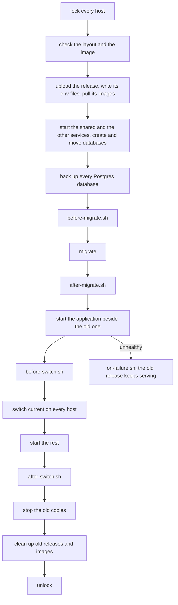

# 🚀 Deploy [🔍](../../docker/deploy.sh 'Go to source')

A deploy puts your published image onto your servers over SSH.
Each server keeps the last releases side by side. Going back takes seconds and no build.

## Usage

Name the servers in a stage file:

```ini
# ./.env.production

COMPOSE_PROJECT_NAME=acme-shop
IMAGE_NAME=acme-shop
IMAGE_TARGET=prod
COMPOSE_FILE=./conf/compose.prod.yaml
DEPLOY_HOSTS=deploy@203.0.113.10
DEPLOY_PATH=/srv/acme-shop
SERVER_NAME=acme-shop.example.com
```

`COMPOSE_PROJECT_NAME` is required, in lowercase. From CI, every release deploys after approval,
see [deploying](../github/deploying.md). To deploy from your machine, take `deploy.sh` out of the build image
and call it with the action and the target:

```sh
docker run --rm --entrypoint cat docker.io/brnshkr/forge:<tag>-app-dev@sha256:<digest> \
  /usr/local/share/forge/deploy.sh >./.cache/deploy.sh
VERSION=1.2.3 sh ./.cache/deploy.sh deploy production
```

`VERSION` is a published version or a testing build's `dev-<short sha>`.
The servers need Docker, Compose, and an SSH user in the `docker` group. Your machine needs `sh`, `ssh`, and `docker`.



Each step runs on every host before the next one starts. If a step fails before the old copies stop,
the deploy points every host back at the old release, marks the new one bad, and runs `on-failure.sh`.

| Action | Does |
| --- | --- |
| `deploy` | deploys `VERSION` |
| `rollback` | goes back one release, further with each call |
| `restart` | recreates your application, e.g. after changing `shared/.env.local` |
| `restore` | restores the databases as they were before the current release |
| `remove` | takes the target off its servers |
| `shared` | recreates the services the server shares, e.g. after a bump |
| `unlock` | clears the lock of a deploy that was killed |

Before uploading, a deploy refuses what only development runs: `FORGE_HOT_RELOAD=1`, a `watch` in `FORGE_WORKER_CONFIG`,
a service mounting your project over `/app`, an `-app-dev` `FORGE_APP_IMAGE`, `mailpit` in production,
and a file in the image's `var/`. With the `symfony` recipe, it also refuses an image without `bin/console`.

The deploy sets `FORGE_APP_IMAGE` to the release it ships.
Your application is `php-app`, else `bun-app`. Workers start only once the new release serves.
Two releases never consume at once.

## Customizing

| Variable | Falls back to | Changes |
| --- | --- | --- |
| `DEPLOY_HOSTS` | — | which hosts get the release, each `[user@]host[:port]`, an IPv6 address in brackets |
| `DEPLOY_USER`, `DEPLOY_PORT` | SSH's | which user and port a host without them uses |
| `DEPLOY_PATH` | — | where the target lives on each host |
| `DEPLOY_IMAGE` | the target | which stage's image this target deploys |
| `DEPLOY_IMAGE_REPOSITORY` | `<registry>/<namespace>/<IMAGE_NAME>` | where the image is deployed from |
| `DEPLOY_REGISTRY` | — | which registry that default uses |
| `DEPLOY_NAMESPACE` | the owner of `origin` | which namespace that default uses |
| `DEPLOY_KEEP_RELEASES` | — | how many releases each host keeps |
| `DEPLOY_WAIT_TIMEOUT` | — | how long a release may take to become healthy |
| `DEPLOY_SHARED_SERVICES` | — | which services other targets share, see [shared services](./shared.md) |
| `DEPLOY_SHARED_PATH` | — | where those services live on each host |
| `DEPLOY_RECIPES` | detected | which recipes run, see [hooks](./hooks.md) |
| `DEPLOY_APP_ENV` | — | which environment the target runs, see [secrets](./secrets.md) |
| `DEPLOY_ROLLBACK_RESTORE` | — | `1` also restores the databases on a rollback, see [server](./server.md) |
| `DEPLOY_REMOVE_DATA` | — | `1` also removes the volumes and `DEPLOY_PATH` on `remove` |

The defaults are in [`deploy.sh`](../../docker/deploy.sh).

With `DOTENV = ./conf/.env` in your Makefile, the deploy reads `./conf/.env.<stage>` instead.
Without the shared Makefile of [@brnshkr/config](https://github.com/brnshkr/config), set `DEPLOY_DOTENV_BASE`:

```sh
DEPLOY_DOTENV_BASE=./conf/.env VERSION=1.2.3 sh ./.cache/deploy.sh deploy production
```

| Page | Covers |
| --- | --- |
| [Stages](./stages.md) | testing, staging, production, and your own |
| [Hooks](./hooks.md) | what your framework and your scripts run on each deploy |
| [Server](./server.md) | what lives where, releases, and backups |
| [Zero downtime](./zero-downtime.md) | the proxy and what your app has to follow |
| [Shared services](./shared.md) | several targets and projects on one server |
| [Secrets](./secrets.md) | values only the server knows |
