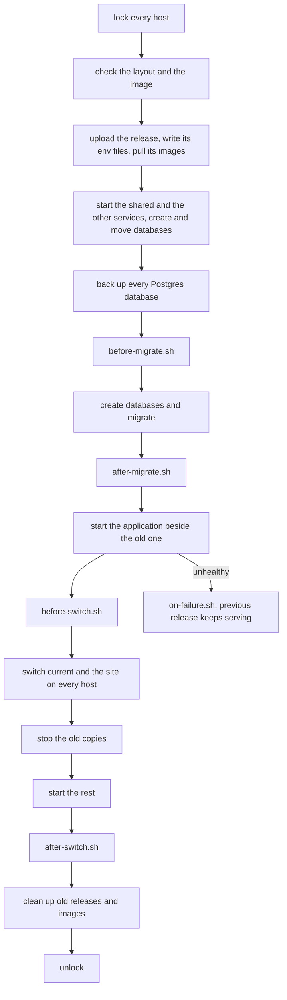

# 🚀 Deploy [🔍](../../docker/deploy.sh 'Go to source')

A deploy puts your published image onto your servers over SSH, with nothing installed there but Docker and Compose.
Each server keeps the last releases side by side, so going back takes seconds and no build.

## Usage

Each system you deploy to is a stage file naming its hosts ([Stages](./stages.md)):

```dotenv
# ./.env.production

IMAGE_NAME=acme-shop
IMAGE_TARGET=prod
COMPOSE_FILE=./conf/compose.prod.yaml
DEPLOY_HOSTS=deploy@203.0.113.10
DEPLOY_PATH=/srv/acme-shop
SERVER_NAME=acme-shop.example.com
```

Deploy a published version, `1.2.3` or a testing build's `dev-<short sha>`:

```sh
make production-deploy VERSION=1.2.3
```

Without [`@brnshkr/config`](https://github.com/brnshkr/config)'s Makefile, take `deploy.sh` out of the image you build
on and call it with the action and the target:

```sh
docker run --rm --entrypoint cat ghcr.io/brnshkr/forge-app:<tag>-dev@sha256:<digest> \
  /usr/local/share/forge/deploy.sh >./.cache/deploy.sh
VERSION=1.2.3 sh ./.cache/deploy.sh deploy production
```

The server needs Docker, Compose, and an SSH user in the `docker` group; your machine needs `sh`, `ssh`, and `docker`.
CI deploys too ([GitHub docs](../github/deploying.md)).



Each step runs on every host before the next one starts. A step failing before the switch marks the release bad,
points every host that already switched back, and runs `on-failure.sh`.

- [Stages](./stages.md) — testing, staging, production, and your own
- [Hooks](./hooks.md) — what your framework and your project run on each deploy
- [Server](./server.md) — what lives where, and going back
- [Zero downtime](./zero-downtime.md) — the proxy, and what your application has to follow
- [Shared services](./shared.md) — several systems and projects on one server
- [Secrets](./secrets.md) — values only the server knows

## Customizing

| Variable | Effect |
| --- | --- |
| `DEPLOY_HOSTS` | the hosts, each `[user@]host[:port]`, an IPv6 address in brackets |
| `DEPLOY_USER`, `DEPLOY_PORT` | the user and port where a host leaves them out |
| `DEPLOY_PATH` | the directory of this target on each host |
| `DEPLOY_IMAGE` | the stage whose image this target deploys, its own by default |
| `DEPLOY_IMAGE_REPOSITORY` | the repository to deploy from, `ghcr.io/<owner of origin>/<IMAGE_NAME>` by default |
| `DEPLOY_REGISTRY`, `DEPLOY_NAMESPACE` | the registry and owner in that default |
| `DEPLOY_KEEP_RELEASES` | how many releases each host keeps |
| `DEPLOY_WAIT_TIMEOUT` | how many seconds a release may take to become healthy |
| `DEPLOY_SHARED_SERVICES` | the services this target shares with others on its servers ([Shared services](./shared.md)) |
| `DEPLOY_SHARED_PATH` | the directory those shared services live in on each host |
| `DEPLOY_RECIPES` | the recipes to run ([Hooks](./hooks.md)) |
| `DEPLOY_APP_ENV` | the environment the system runs ([Secrets](./secrets.md)) |
| `DEPLOY_ROLLBACK_RESTORE`, `DEPLOY_REMOVE_DATA` | `1` to also undo the data on a rollback or a removal ([Server](./server.md)) |

Every switch takes `0` or `1`, and a deploy refuses anything else before it connects.
The stage files move with `@brnshkr/config`'s `DOTENV`, in CI too, here to `./conf/.env.production`:

```makefile
# ./Makefile

DOTENV = ./conf/.env
```

Before uploading, a deploy refuses what only development runs: `FORGE_HOT_RELOAD=1`, a `watch` in `FORGE_WORKER_CONFIG`,
a service that mounts your project over `/app`, and a `-dev` `FORGE_RUNTIME_IMAGE`.
