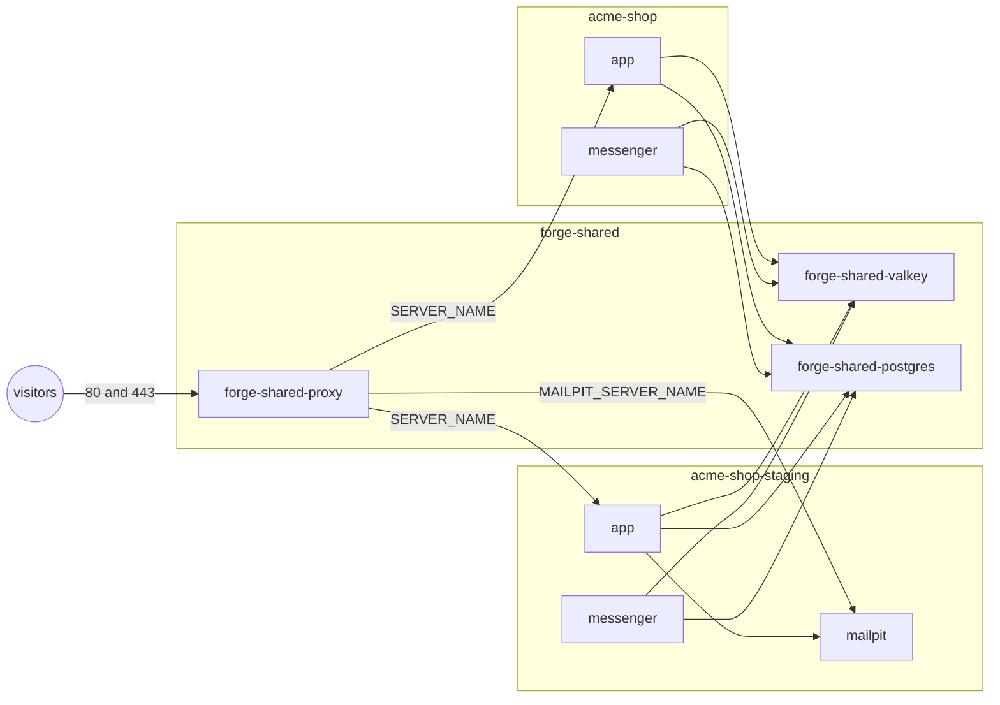

# 🤝 Shared services [🔍](../../docker/deploy.sh 'Go to source')

Testing, staging, and production may share a server, and so may several projects. Each target runs as a Compose
project of its own, `<COMPOSE_PROJECT_NAME>` for production and `<COMPOSE_PROJECT_NAME>-<target>` for every other,
with its own containers and volumes; a deploy without `COMPOSE_PROJECT_NAME` fails.
What the server shares runs once, each service in a Compose project of its own under `DEPLOY_SHARED_PATH`.



## Usage

The proxy is shared whenever a release includes its fragment. Valkey, Postgres, and Mailpit are shared on request:

```dotenv
# ./.env.staging

DEPLOY_SHARED_SERVICES=valkey postgres
```

Each target then keeps its data apart by its own Valkey database number and its own Postgres database and login:

```dotenv
# /srv/acme-shop-staging/shared/.env.local

VALKEY_URL=valkey://forge-shared-valkey:6379/1
DATABASE_URL=postgresql://acme_staging:<password>@forge-shared-postgres:5432/acme_shop_staging
```

A deploy creates or updates the role `POSTGRES_USER` with `POSTGRES_PASSWORD`, owning `POSTGRES_DB`
and `POSTGRES_EXTRA_DATABASES`, which nobody else may connect to; a role another project created fails the deploy.
A deploy backs up only its target's own databases there, so back up the rest of a shared Postgres yourself.

What runs in `forge-shared` keeps the version of the deploy that started it, so no project ever moves a service
the others depend on. When your pins move ahead, a deploy prints what differs; `make production-deploy-shared`
takes them. The shared volumes keep their fragment's names, e.g. `forge-valkey-data`.

Moving a service between a project and `forge-shared` moves its data: the next deploy copies
the target's databases or the keys of its Valkey database before migrating.
It fails where the destination already holds tables or keys, and the old volume stays.

## Customizing

A Valkey database number separates keys, but not who may read them.
Projects that don't trust each other let the shared Valkey require logins:

```dotenv
# ./.env.production

DEPLOY_SHARED_SERVICES=valkey
VALKEY_REQUIRE_ACL=1
VALKEY_PASSWORD=<password>
VALKEY_URL=valkey://acme-shop:<password>@forge-shared-valkey:6379
```

The deploy that creates it, or `make production-deploy-shared`, turns the logins on;
until then, a deploy refuses a shared Valkey running without them.
Every target on it then needs a `VALKEY_PASSWORD`, from which the deploy creates its user, named like its Compose
project and limited to keys under `<name>:`, so your application prefixes every key with it, e.g. `acme-shop:`.
