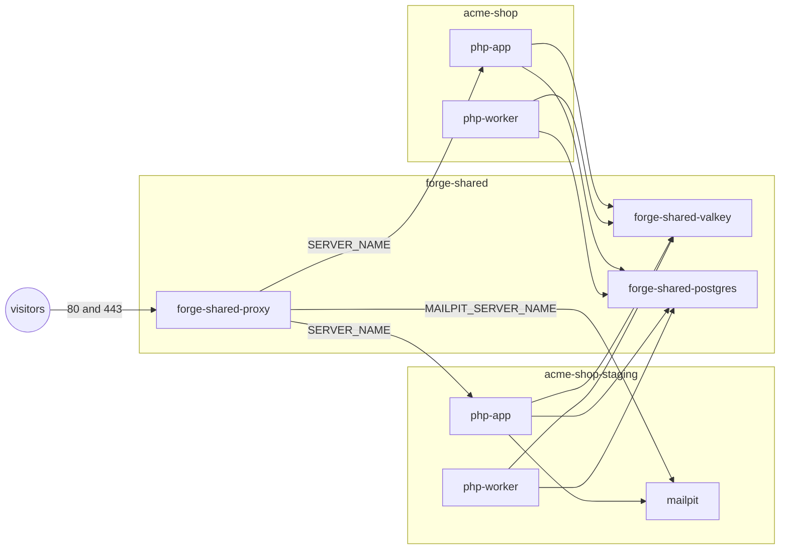

# 🤝 Shared services [🔍](../../docker/deploy.sh 'Go to source')

Testing, staging, and production may share a server, and so may several projects.

## Usage

Each target runs as a Compose project of its own: `<COMPOSE_PROJECT_NAME>` for production,
`<COMPOSE_PROJECT_NAME>-<target>` for every other. It keeps its own containers and volumes.
What the server shares runs once, as `forge-shared-<service>` under `DEPLOY_SHARED_PATH`.



The proxy is shared whenever a release includes it. Valkey, Postgres, and Mailpit are shared on request.
The release must still include their fragments:

```ini
# ./.env.staging

DEPLOY_SHARED_SERVICES=valkey postgres
```

Each target keeps its data apart, with its own Valkey database number and its own Postgres database and login:

```ini
# /srv/acme-shop-staging/shared/.env.local

VALKEY_URL=valkey://forge-shared-valkey:6379/1
DATABASE_URL=postgresql://acme_staging:<password>@forge-shared-postgres:5432/acme_shop_staging
```

A deploy creates or updates the role `POSTGRES_USER` with `POSTGRES_PASSWORD`.
The role owns `POSTGRES_DB` and `POSTGRES_EXTRA_DATABASES`, and nobody else may connect to them.
A role belongs to one project. A role another project created fails the deploy.
A deploy backs up only its target's own databases there. Back up the rest of a shared Postgres yourself.

A shared service keeps the version of the deploy that started it. No project moves a service the others depend on.
When your pins move ahead, a deploy prints what differs. The `shared` action applies them.
The shared volumes keep their fragment's names, e.g. `forge-valkey-data`.

Moving a service between a project and `forge-shared` moves its data.
The next deploy copies the target's databases, or the keys of its Valkey database, before migrating.
It fails where the destination already holds tables or keys, and the old volume stays.

## Valkey logins

A Valkey database number separates keys, but not who may read them.
Projects that don't trust each other let the shared Valkey require logins:

```ini
# ./.env.production

DEPLOY_SHARED_SERVICES=valkey
VALKEY_REQUIRE_ACL=1
VALKEY_PASSWORD=<password>
VALKEY_URL=valkey://acme-shop:<password>@forge-shared-valkey:6379
```

The deploy that creates the shared Valkey starts it with logins.
For one already running without them, run the `shared` action first, or the deploy fails.
Every target on it then needs `VALKEY_PASSWORD`. The deploy creates a user named like the target's Compose project.
That user reaches only keys under `<name>:`. Prefix every key with it, e.g. `acme-shop:`.

## Mailpit on the proxy

A shared Mailpit gets its own name through the proxy with `MAILPIT_SERVER_NAME`.
Its logins live in `.env.mailpit.local`, see [secrets](./secrets.md).
