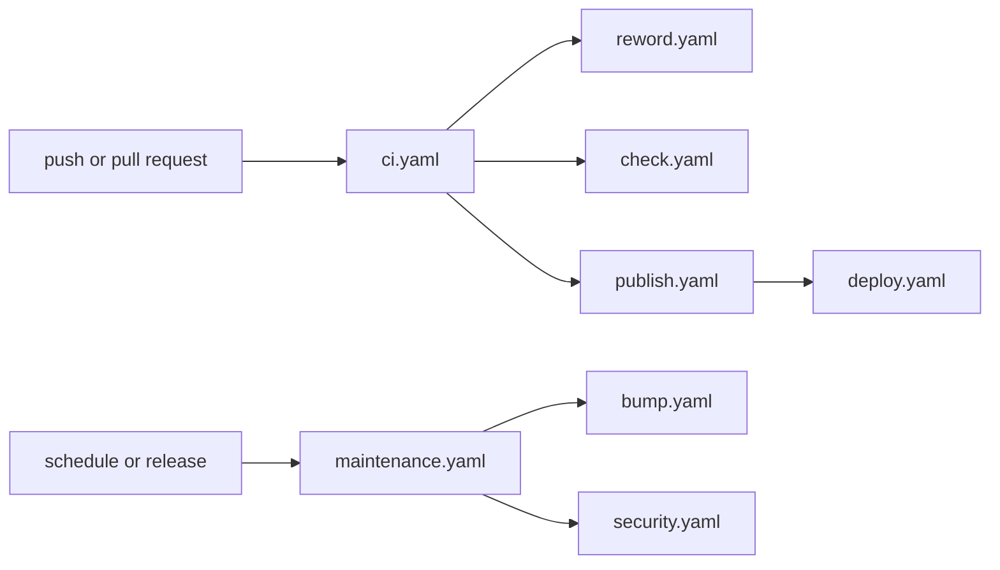

# 🐙 GitHub [🔍](../../.github/workflows/ 'Go to source')

Your repository calls `ci.yaml` on pushes and pull requests, and `maintenance.yaml`
on a schedule and whenever another repository of your organization publishes a release:



## Usage

```yaml
# ./.github/workflows/ci.yaml

on:
  push:
    branches:
      - dev/*
      - release/*

  pull_request:
    branches:
      - dev/*
      - release/*

jobs:
  ci:
    permissions:
      contents: write
      id-token: write
      packages: write
      pages: write
      security-events: write
    uses: brnshkr/forge/.github/workflows/ci.yaml@<commit> # <tag>
    secrets:
      BOT_CLIENT_ID: ${{ secrets.BOT_CLIENT_ID }}
      BOT_PRIVATE_KEY: ${{ secrets.BOT_PRIVATE_KEY }}
      NPM_CONFIG_TOKEN: ${{ secrets.NPM_CONFIG_TOKEN }}
      PACKAGIST_TOKEN: ${{ secrets.PACKAGIST_TOKEN }}
      PACKAGIST_USERNAME: ${{ secrets.PACKAGIST_USERNAME }}
```

```yaml
# ./.github/workflows/maintenance.yaml

on:
  schedule:
    - cron: 20 16 * * 2,5

  repository_dispatch:
    types:
      - brnshkr-release

  workflow_dispatch: {}

jobs:
  maintenance:
    permissions:
      contents: read
      security-events: write
    uses: brnshkr/forge/.github/workflows/maintenance.yaml@<commit> # <tag>
    secrets:
      BOT_CLIENT_ID: ${{ secrets.BOT_CLIENT_ID }}
      BOT_PRIVATE_KEY: ${{ secrets.BOT_PRIVATE_KEY }}
```

Schedule it at least twice a week, so the bump's record of new versions stays in the Actions cache
([eviction policy](https://docs.github.com/en/actions/reference/workflows-and-actions/dependency-caching#usage-limits-and-eviction-policy)).
Their inputs are described in the [workflow files](../../.github/workflows),
and the settings they need in the [Setup docs](./setup.md).

## Customizing

Each workflow can also be called on its own:

- [Checks](./checks.md) — `check.yaml`, the fixes and the test matrix
- [Publishing](./publishing.md) — `publish.yaml`, images, packages, and GitHub Pages
- [Deploying](./deploying.md) — `deploy.yaml` and its environments
- [Security](./security.md) — `security.yaml` and its four scanners
- [Dependabot](./dependabot.md) — `reword.yaml`
- `bump.yaml` — described in the [Pins docs](../pins.md#your-projects-pins)
- [Skipping jobs](./skipping-jobs.md) — turning off what your repository doesn't want
- [Without `@brnshkr/config`](./without-config.md) — the commands the workflows run
