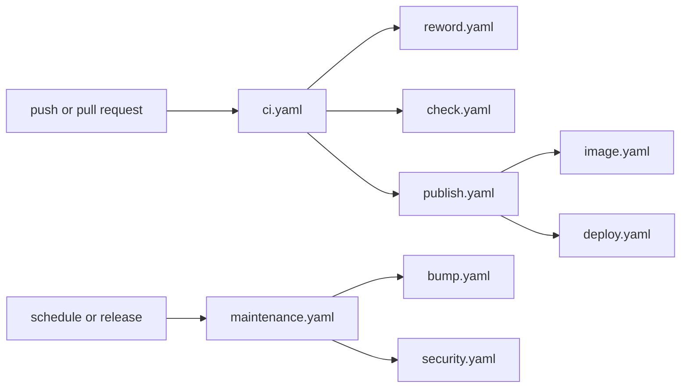

# 🐙 GitHub [🔍](../../.github/workflows/ 'Go to source')

Your repository calls two of Forge's workflows. They call the rest.

## Usage

```yaml
# ./.github/workflows/ci.yaml

name: CI

on:
  push:
    branches:
      - dev/*
      - release/*

  pull_request:
    branches:
      - dev/*
      - release/*

permissions:
  contents: read

jobs:
  ci:
    name: CI
    permissions:
      contents: write
      id-token: write
      packages: write
      pages: write
      security-events: write
    uses: brnshkr/forge/.github/workflows/ci.yaml@<commit> # <tag>
    secrets:
      BOT_CLIENT_ID: ${{ secrets.BOT_CLIENT_ID }}
      BOT_PRIVATE_KEY: ${{ secrets.BOT_PRIVATE_KEY }}
      NPM_CONFIG_TOKEN: ${{ secrets.NPM_CONFIG_TOKEN }}
      PACKAGIST_TOKEN: ${{ secrets.PACKAGIST_TOKEN }}
      PACKAGIST_USERNAME: ${{ secrets.PACKAGIST_USERNAME }}
```

```yaml
# ./.github/workflows/maintenance.yaml

name: Maintenance

on:
  schedule:
    - cron: 20 16 * * 2,5

  repository_dispatch:
    types:
      - brnshkr-release

  workflow_dispatch: {}

permissions:
  contents: read

jobs:
  maintenance:
    name: Maintenance
    permissions:
      contents: read
      security-events: write
    uses: brnshkr/forge/.github/workflows/maintenance.yaml@<commit> # <tag>
    secrets:
      BOT_CLIENT_ID: ${{ secrets.BOT_CLIENT_ID }}
      BOT_PRIVATE_KEY: ${{ secrets.BOT_PRIVATE_KEY }}
```

`maintenance.yaml` also runs when another repository of your organization publishes a release.
Schedule it at least twice a week. The bump's record of new versions then stays in the Actions cache.
GitHub may start a scheduled run hours late under load, and may drop it.
Take a look at the [setup](./setup.md) for what your organization and repository need once.



## Workflows

Every workflow takes the inputs `runner` and `skip`. `runner` defaults to the `RUNNER_IMAGE` variable.
Each one can also be called on its own:

| Workflow | Page |
| --- | --- |
| `check.yaml` | [Checks](./checks.md) |
| `publish.yaml`, `image.yaml` | [Publishing](./publishing.md) |
| `deploy.yaml` | [Deploying](./deploying.md) |
| `security.yaml` | [Security](./security.md) |
| `reword.yaml` | [Dependabot](./dependabot.md) |
| `bump.yaml` | [Pins](../pins.md) |
| the `skip` input | [Skipping jobs](./skipping-jobs.md) |

`ci.yaml` passes its inputs on to these. The [workflow files](../../.github/workflows) describe every input.
