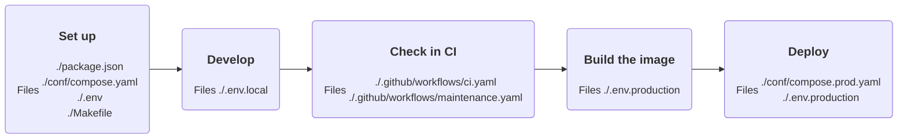

# 🥟 Your Bun app

Take a Bun server with a queue worker from an empty repository to its server.



## Set up

`./package.json` names two scripts. `start` runs the server and `worker` runs the queue worker:

```json
{
  "name": "acme-shop",
  "private": true,
  "type": "module",
  "scripts": {
    "start": "bun ./src/server.ts",
    "worker": "bun ./src/worker.ts"
  }
}
```

The server listens where the fragments tell it, on `0.0.0.0:80`:

```ts
// ./src/server.ts

Bun.serve({
  hostname: process.env.HOST,
  port: Number(process.env.PORT),
  fetch: () => new Response('Hello from acme-shop'),
});
```

```ts
// ./src/worker.ts

setInterval(() => {
  console.log('Waiting for jobs');
}, 60_000);
```

A request to `/` must answer below 500. That is the health check.

Include the app and its worker:

```yaml
# ./conf/compose.yaml

include:
  - path: oci://${FORGE_FRAGMENT_NAMESPACE:-${FORGE_NAMESPACE:?}}/forge-compose-bun-app-dev:${FORGE_TAG:?}@${FORGE_BUN_APP_DEV_FRAGMENT_DIGEST:?}
  - path: oci://${FORGE_FRAGMENT_NAMESPACE:-${FORGE_NAMESPACE:?}}/forge-compose-bun-worker-dev:${FORGE_TAG:?}@${FORGE_BUN_WORKER_DEV_FRAGMENT_DIGEST:?}
```

```ini
# ./.env

COMPOSE_PROJECT_NAME=acme-shop
APP_HTTP_PORT=3000

FORGE_TAG=<tag>
FORGE_IMAGE_NAME=forge-bun
FORGE_APP_DEV_IMAGE_DIGEST=sha256:<digest> # <version>
FORGE_BUN_APP_DEV_FRAGMENT_DIGEST=sha256:<digest> # <version>
FORGE_BUN_WORKER_DEV_FRAGMENT_DIGEST=sha256:<digest> # <version>
```

Read each digest once:

```sh
docker buildx imagetools inspect docker.io/brnshkr/forge-bun:<tag>-app-dev
docker buildx imagetools inspect docker.io/brnshkr/forge-compose-bun-app-dev:<tag>
docker buildx imagetools inspect docker.io/brnshkr/forge-compose-bun-worker-dev:<tag>
```

From then on the maintenance workflow bumps them with a pull request.

Install [@brnshkr/config](https://github.com/brnshkr/config) once inside the container,
then copy the starter Makefile and let it write the rest:

```sh
export FORGE_NAMESPACE=docker.io/brnshkr HOST_UID=$(id -u) HOST_GID=$(id -g)

docker compose --env-file ./.env --file ./conf/compose.yaml run --rm bun-app bun a -D -E @brnshkr/config
cp -v ./node_modules/@brnshkr/config/conf/Makefile.dist ./Makefile
make startup
```

From now on the Makefile sets the variables above and runs every tool in `bun-app`.

## Develop

```sh
make up
```

The fragments run `bun --watch run start` and `bun --watch run worker` on your working copy.
The app answers on `http://127.0.0.1:3000`, plain HTTP.
`make ci` checks it, `make shell` opens a shell in `bun-app`, and `make help` lists the rest.

To debug, turn on the inspector in `./.env.local`. Git ignores it:

```ini
# ./.env.local

FORGE_INSPECT=1
```

Run `make up` again, attach your debugger to `ws://127.0.0.1:6499/`, and map `/app` to your working copy.
[`bun-app`](../compose/bun-app.md) lists every variable.

### Without the shared Makefile

```sh
docker compose --env-file ./.env --env-file ./.env.local --file ./conf/compose.yaml up --wait
```

## Check in CI

Call Forge's workflows from two files:

```yaml
# ./.github/workflows/ci.yaml

name: CI

on:
  push:
    branches:
      - dev/*
      - release/*

  pull_request:
    branches:
      - dev/*
      - release/*

permissions:
  contents: read

jobs:
  ci:
    name: CI
    permissions:
      contents: write
      id-token: write
      packages: write
      pages: write
      security-events: write
    uses: brnshkr/forge/.github/workflows/ci.yaml@<commit> # <tag>
    secrets:
      BOT_CLIENT_ID: ${{ secrets.BOT_CLIENT_ID }}
      BOT_PRIVATE_KEY: ${{ secrets.BOT_PRIVATE_KEY }}
```

```yaml
# ./.github/workflows/maintenance.yaml

name: Maintenance

on:
  schedule:
    - cron: 20 16 * * 2,5

  repository_dispatch:
    types:
      - brnshkr-release

permissions:
  contents: read

jobs:
  maintenance:
    name: Maintenance
    permissions:
      contents: read
      security-events: write
    uses: brnshkr/forge/.github/workflows/maintenance.yaml@<commit> # <tag>
    secrets:
      BOT_CLIENT_ID: ${{ secrets.BOT_CLIENT_ID }}
      BOT_PRIVATE_KEY: ${{ secrets.BOT_PRIVATE_KEY }}
```

The [GitHub setup](../github/setup.md) covers the bot and the secrets.
CI runs `make ci` in the same container you develop in.

## Build the image

Name the image in a stage file:

```ini
# ./.env.production

IMAGE_NAME=acme-shop
IMAGE_TARGET=prod
FORGE_APP_IMAGE_DIGEST=sha256:<digest> # <version>
```

Read the digest once with `docker buildx imagetools inspect docker.io/brnshkr/forge-bun:<tag>-app`.
Forge's Dockerfile installs your dependencies on `forge-bun:<tag>-app-dev` and runs the result on `forge-bun:<tag>-app`.
Every tracked file ships. Leave paths out with `IMAGE_EXCLUDE`.

Every push builds and scans the image. Every release publishes it.
Packages and a Dockerfile of your own are in [your image](../images/your-image.md).

## Deploy

Run the app's own image behind the proxy, with its worker:

```yaml
# ./conf/compose.prod.yaml

include:
  - path: oci://${FORGE_FRAGMENT_NAMESPACE:-${FORGE_NAMESPACE:?}}/forge-compose-bun-app:${FORGE_TAG:?}@${FORGE_BUN_APP_FRAGMENT_DIGEST:?}
  - path: oci://${FORGE_FRAGMENT_NAMESPACE:-${FORGE_NAMESPACE:?}}/forge-compose-bun-worker:${FORGE_TAG:?}@${FORGE_BUN_WORKER_FRAGMENT_DIGEST:?}
  - path: oci://${FORGE_FRAGMENT_NAMESPACE:-${FORGE_NAMESPACE:?}}/forge-compose-proxy:${FORGE_TAG:?}@${FORGE_PROXY_FRAGMENT_DIGEST:?}
```

Name the server and the pins in the stage file:

```ini
# ./.env.production

IMAGE_NAME=acme-shop
IMAGE_TARGET=prod
FORGE_APP_IMAGE_DIGEST=sha256:<digest> # <version>

COMPOSE_FILE=./conf/compose.prod.yaml
DEPLOY_HOSTS=deploy@203.0.113.10
DEPLOY_PATH=/srv/acme-shop
SERVER_NAME=acme-shop.example.com

PROXY_TAG=<tag>
PROXY_IMAGE_DIGEST=sha256:<digest> # <version>
FORGE_BUN_APP_FRAGMENT_DIGEST=sha256:<digest> # <version>
FORGE_BUN_WORKER_FRAGMENT_DIGEST=sha256:<digest> # <version>
FORGE_PROXY_FRAGMENT_DIGEST=sha256:<digest> # <version>
```

The proxy terminates HTTPS for `SERVER_NAME` and routes to `bun-app`.
The server needs Docker, Compose, and an SSH user in the `docker` group.
In GitHub, create the environment `production` with required reviewers. Give it these secrets:

| Secret | Value |
| --- | --- |
| `DEPLOY_SSH_KEY` | the private key of `deploy@203.0.113.10` |
| `DEPLOY_DOTENV` | the values only the server knows |

Add the server's host key to the repository variable `DEPLOY_KNOWN_HOSTS`.
Every release now deploys to `production` after approval. The deploy sets `FORGE_APP_IMAGE` to the release.
The proxy moves traffic to the new server once it answers, then the new worker starts.
Take a look at the [deploy docs](../deploy/index.md) and at [deploying](../github/deploying.md).

## Add services

Include a service in `./conf/compose.yaml` to develop with it and in `./conf/compose.prod.yaml` to deploy it:

| Service | Fragment | Shared per server | Reference |
| --- | --- | --- | --- |
| Postgres | `postgres` | yes | [Postgres](../compose/postgres.md) |
| Valkey | `valkey` | yes, with `VALKEY_PASSWORD` | [Valkey](../compose/valkey.md) |
| Mercure | `mercure` | no | [Mercure](../compose/mercure.md) |
| Mailpit | `mailpit` | yes, never in production | [Mailpit](../compose/mailpit.md) |

`DEPLOY_SHARED_SERVICES=postgres` in `./.env.production` runs Postgres once per server for every project there.
Each project keeps its own role and database.
[Shared services](../deploy/shared.md) explains how they move and what they need.
