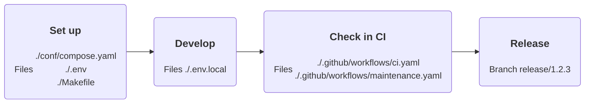

# 🧱 Your library

Take a PHP or Bun library from an empty repository to its first release.



## Set up

Include the `cli` fragment:

```yaml
# ./conf/compose.yaml

include:
  - path: oci://${FORGE_FRAGMENT_NAMESPACE:-${FORGE_NAMESPACE:?}}/forge-compose-cli:${FORGE_TAG:?}@${FORGE_CLI_FRAGMENT_DIGEST:?}
```

Pin the release, the image, and the fragment:

```ini
# ./.env

FORGE_TAG=<tag>
FORGE_CLI_IMAGE_DIGEST=sha256:<digest> # <version>
FORGE_CLI_FRAGMENT_DIGEST=sha256:<digest> # <version>
```

Read both digests once:

```sh
docker buildx imagetools inspect docker.io/brnshkr/forge:<tag>-cli
docker buildx imagetools inspect docker.io/brnshkr/forge-compose-cli:<tag>
```

From then on the maintenance workflow bumps them with a pull request.
The `forge` image holds PHP, Composer, and Bun.
For only one of them, add `FORGE_IMAGE_NAME=forge-php` or `FORGE_IMAGE_NAME=forge-bun` to `./.env`.
Take a look at the [images](../images/index.md) for what each one holds.

For browser tests, include `cli-chromium` instead of `cli`.
It adds Chromium, ChromeDriver, and fonts.
Its pins are `FORGE_CLI_CHROMIUM_IMAGE_DIGEST` and `FORGE_CLI_CHROMIUM_FRAGMENT_DIGEST`.

Install [@brnshkr/config](https://github.com/brnshkr/config) once inside the container,
then copy the starter Makefile and let it write the rest. Your machine needs nothing but Docker and Make:

```sh
export FORGE_NAMESPACE=docker.io/brnshkr HOST_UID=$(id -u) HOST_GID=$(id -g)

docker compose --env-file ./.env --file ./conf/compose.yaml run --rm cli bun a -D -E @brnshkr/config
docker compose --env-file ./.env --file ./conf/compose.yaml run --rm cli composer r --dev brnshkr/config
cp -v ./node_modules/@brnshkr/config/conf/Makefile.dist ./Makefile \
  && make startup
```

Drop the install line of a stack your library doesn't use.
For a PHP-only library, copy the starter from `./vendor/brnshkr/config/conf/Makefile.dist`.
From now on the Makefile sets the variables above and runs every tool in `cli`.

## Develop

```sh
make ci
make shell
make help
```

`make ci` fixes, checks, audits, and tests. `make shell` opens a shell in `cli`. `make help` lists the rest.

Each image holds Git, Make, Graphviz, ShellCheck, hadolint, and actionlint.
With PHP it also holds Xdebug and PCOV. Your Git settings and shell history survive in the volume `forge-home`.

Personal settings go in `./.env.local`. Git ignores it:

```ini
# ./.env.local

XDEBUG_MODE=debug
```

The [`cli` fragment](../compose/cli.md) lists every variable it passes through.

### Without the shared Makefile

```sh
docker compose --env-file ./.env --env-file ./.env.local --file ./conf/compose.yaml run --rm cli sh
```

## Check in CI

Call Forge's workflows from two files:

```yaml
# ./.github/workflows/ci.yaml

name: CI

on:
  push:
    branches:
      - dev/*
      - release/*

  pull_request:
    branches:
      - dev/*
      - release/*

permissions:
  contents: read

jobs:
  ci:
    name: CI
    permissions:
      contents: write
      id-token: write
      packages: write
      pages: write
      security-events: write
    uses: brnshkr/forge/.github/workflows/ci.yaml@<commit> # <tag>
    secrets:
      BOT_CLIENT_ID: ${{ secrets.BOT_CLIENT_ID }}
      BOT_PRIVATE_KEY: ${{ secrets.BOT_PRIVATE_KEY }}
      NPM_CONFIG_TOKEN: ${{ secrets.NPM_CONFIG_TOKEN }}
      PACKAGIST_TOKEN: ${{ secrets.PACKAGIST_TOKEN }}
      PACKAGIST_USERNAME: ${{ secrets.PACKAGIST_USERNAME }}
```

```yaml
# ./.github/workflows/maintenance.yaml

name: Maintenance

on:
  schedule:
    - cron: 20 16 * * 2,5

  repository_dispatch:
    types:
      - brnshkr-release

permissions:
  contents: read

jobs:
  maintenance:
    name: Maintenance
    permissions:
      contents: read
      security-events: write
    uses: brnshkr/forge/.github/workflows/maintenance.yaml@<commit> # <tag>
    secrets:
      BOT_CLIENT_ID: ${{ secrets.BOT_CLIENT_ID }}
      BOT_PRIVATE_KEY: ${{ secrets.BOT_PRIVATE_KEY }}
```

The [GitHub setup](../github/setup.md) covers the bot and the secrets.
CI runs `make ci` in the same container you develop in.

To also test against other dependency versions, add rows to `TEST_MATRIX`:

```makefile
# ./Makefile

TEST_MATRIX += composer[*:lowest]
```

CI runs each row as a job of its own, through `make test-matrix`.
The [Makefile docs](https://github.com/brnshkr/config/blob/master/docs/Makefile.md#test-matrix) show every field.

## Release

Push a branch named for the version:

```sh
git switch --create release/1.2.3
git push --set-upstream origin release/1.2.3
```

CI tags the commit `v1`, `v1.2`, and `v1.2.3`, writes the changelog, and publishes to Packagist and npm.
A Composer package gets only `v1.2.3`.

A package's first npm release needs the `NPM_CONFIG_TOKEN` secret and an environment named `registry`.
After it, add a trusted publisher on npmjs.com and delete the token.
See [publishing](../github/publishing.md) for the details.
