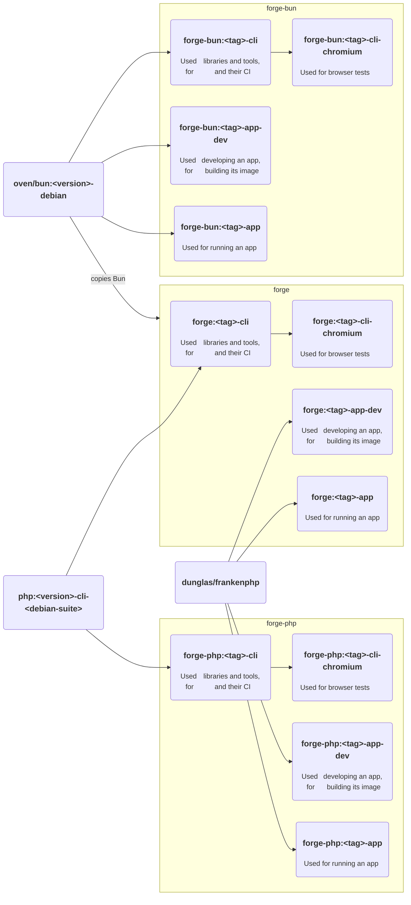

# 📦 Images [🔍](../../docker/ 'Go to source')

Toolchain and runtime images for PHP, Bun, or both, pinned by every Forge release.

## Usage

Pick a stack in `.env`, then pin the image of each role you use:

```ini
# ./.env

FORGE_TAG=<tag>
FORGE_IMAGE_NAME=forge-php
FORGE_CLI_IMAGE_DIGEST=sha256:<digest> # <version>
```

The [Compose fragments](../compose/index.md) turn this into `docker.io/brnshkr/forge-php:<tag>-cli@sha256:<digest>`.
Read a digest once with `docker buildx imagetools inspect docker.io/brnshkr/forge-php:<tag>-cli`.

## Stacks

| Image | Holds |
| --- | --- |
| `forge` | PHP, Composer, and Bun. The default. |
| `forge-php` | PHP and Composer |
| `forge-bun` | Bun |

Every release is published to `docker.io/brnshkr` and `ghcr.io/brnshkr`. Projects pull from Docker Hub by default.
`FORGE_NAMESPACE=ghcr.io/brnshkr` pulls from GHCR.

## Roles

Each stack has four roles. The role is the tag's suffix.

| Role | Used for | Built on |
| --- | --- | --- |
| `-cli` | libraries and tools, and their CI | `php:<version>-cli-<debian-suite>`, `oven/bun:<version>-debian` for `forge-bun` |
| `-cli-chromium` | browser tests | the same base as `-cli` |
| `-app-dev` | developing an app, building its image | `dunglas/frankenphp`, `oven/bun` for `forge-bun` |
| `-app` | running an app | the same base as `-app-dev` |



## Tags

A stable release `1.2.3` pushes these tags for each role:

| Tag | Example |
| --- | --- |
| major | `forge:1-cli` |
| minor | `forge:1.2-cli` |
| version | `forge:1.2.3-cli` |
| toolchain | `forge:php8.5-bun1.4-cli`, `forge-php:php8.5-app`, `forge-bun:bun1.4-app-dev` |
| role | `forge-php:app`, the newest stable release |

A prerelease pushes only its own version, e.g. `forge:1.3.0-rc.1-app`. Below 1.0.0 there is no major tag.
No image is tagged `latest`.

## Contents

| Role | Holds |
| --- | --- |
| `-cli` | Git, Make, Graphviz, ShellCheck, hadolint, and actionlint. With PHP also Xdebug, PCOV, and `php.ini-development`. |
| `-cli-chromium` | the same, plus Chromium, ChromeDriver, and fonts with emoji. CJK fonts are not included. |
| `-app-dev` | Git, Make, unzip, and `original-awk`. With PHP also Composer, Xdebug, PCOV, `apcu`, and `php.ini-development`. |
| `-app` | no Git and no Make. With PHP also `apcu` and `php.ini-production`, plus JIT. |

Every image with PHP has `bcmath`, `exif`, `imagick` (JPEG, PNG, GIF, WebP, AVIF), `intl`, `opcache`, `pcntl`,
`pdo_pgsql`, `redis`, and `zip`. `forge-install` adds more at build time, see [your image](./your-image.md).
The [PHP settings](./php.md) list what each `php.ini` changes.

`-app` ends as `www-data`. It reads your code and writes only `var/`. A deploy refuses an `-app-dev` image in production.
Every other image ends as the unprivileged user `forge`. No image sends telemetry.
`forge` and `forge-php` serve your app with FrankenPHP, see the [web server](./web-server.md).
