# 📦 Images [🔍](../../docker/ 'Go to source')

Forge publishes PHP-only, Bun-only, and combined toolchain and runtime images. Every tool version in them is pinned
in one place and moves together with a Forge release, so your machine, CI, and your servers run exactly the same
binaries.

```mermaid
%%{init: {
  'themeCSS': 'h3 {margin: 0} table {border-collapse: collapse; margin: 0.4em 0 0} td {border-top: 1px solid #666; padding: 0.3em 0.6em; text-align: right; vertical-align: top} td:first-child {white-space: nowrap; color: #888} td:last-child {text-align: left}'
}}%%
flowchart LR
  php("<h3>php:&lt;version&gt;-cli-&lt;debian-suite&gt;</h3>")
  bun("<h3>oven/bun:&lt;version&gt;-debian</h3>")
  frankenphp("<h3>dunglas/frankenphp</h3>")

  subgraph phpAppRuntime [forge-php-app]
    phpAppDev("<h3>forge-php-app:&lt;tag&gt;-dev</h3><table><tr><td>Used for</td><td>Developing PHP-only web projects</td></tr><tr><td>Adds</td><td>Composer · Xdebug · PCOV</td></tr></table>")
    phpApp("<h3>forge-php-app:&lt;tag&gt;</h3><table><tr><td>Used for</td><td>PHP-only web apps</td></tr><tr><td>Runs</td><td>FrankenPHP as www-data</td></tr></table>")
  end

  subgraph bunAppRuntime [forge-bun-app]
    bunAppDev("<h3>forge-bun-app:&lt;tag&gt;-dev</h3><table><tr><td>Used for</td><td>Developing Bun web projects</td></tr><tr><td>Adds</td><td>Bun watch mode and the app build hook</td></tr></table>")
    bunApp("<h3>forge-bun-app:&lt;tag&gt;</h3><table><tr><td>Used for</td><td>Bun-only web apps</td></tr><tr><td>Runs</td><td>Bun as an unprivileged user</td></tr></table>")
  end

  subgraph appRuntime [forge-app]
    appDev("<h3>forge-app:&lt;tag&gt;-dev</h3><table><tr><td>Used for</td><td>Developing PHP and Bun web projects</td></tr><tr><td>Adds</td><td>Composer · Bun · Xdebug · PCOV</td></tr></table>")
    app("<h3>forge-app:&lt;tag&gt;</h3><table><tr><td>Used for</td><td>Combined PHP and Bun web apps</td></tr><tr><td>Runs</td><td>FrankenPHP and Bun</td></tr></table>")
  end

  subgraph toolchains [toolchain images]
    forge("<h3>forge:&lt;tag&gt;</h3><table><tr><td>Used for</td><td>Projects with PHP and JavaScript</td></tr><tr><td>Holds</td><td>PHP · Composer · Bun</td></tr></table>")
    forgePhp("<h3>forge-php:&lt;tag&gt;</h3><table><tr><td>Used for</td><td>PHP libraries and tools</td></tr><tr><td>Holds</td><td>PHP · Composer</td></tr></table>")
    forgeBun("<h3>forge-bun:&lt;tag&gt;</h3><table><tr><td>Used for</td><td>JavaScript libraries and tools</td></tr><tr><td>Holds</td><td>Bun</td></tr></table>")
  end

  php --> forge
  php --> forgePhp
  bun --> forgeBun
  bun --> forge
  frankenphp --> appDev
  frankenphp --> app
  bun --> appDev
  bun --> app
  frankenphp --> phpAppDev
  frankenphp --> phpApp
  bun --> bunAppDev
  bun --> bunApp
```

| Image | Tags |
| --- | --- |
| `forge`, `forge-php`, `forge-bun` | `<tag>`, and `<tag>-chromium` with Chromium, ChromeDriver, and fonts for browser tests |
| `forge-app`, `forge-php-app`, `forge-bun-app` | `<tag>` to run, `<tag>-dev` to develop |

Every toolchain image also holds Git, Make, Graphviz, ShellCheck, hadolint, and actionlint, so
[`@brnshkr/config`](https://github.com/brnshkr/config)'s checks run without anything else installed.
Every image with PHP comes with the extensions `bcmath`, `exif`, `imagick` (JPEG, PNG, GIF, WebP, and AVIF),
`intl`, `opcache`, `pcntl`, `pdo_pgsql`, `redis`, and `zip`, and `forge-install` adds more later.
The PHP runtime images add `apcu` for Symfony's system cache.

Every runtime ends as an unprivileged user and sends no telemetry. `forge-php-app` contains PHP only;
`forge-app` contains PHP and Bun; `forge-bun-app` contains Bun only. Runtime images read code but write only `var/`
([Production](../compose/production.md), [Bun app](../compose/bun-app.md)).

- [Web server](./web-server.md) — the Caddyfile and the switches that change it
- [PHP settings](./php.md) — what the images set and how you override it
- [Your image](./your-image.md) — building your application's image, with or without a Dockerfile of your own

The tags each release publishes are listed in the [Releases docs](../releases.md#tags),
and how their versions stay current in the [Pins docs](../pins.md).
