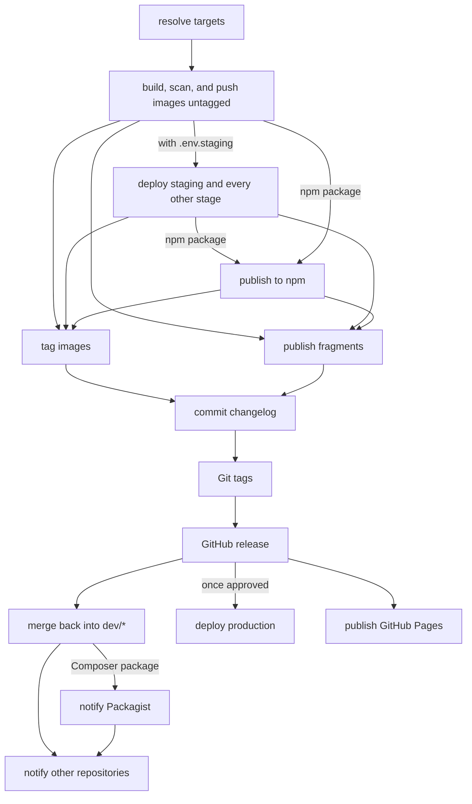

# 🔖 Releases [🔍](../src/shared/release/ 'Go to source')

The branch name decides what CI does and which version a release gets.

## Branches

| Branch | What CI does |
| --- | --- |
| `feature/*`, `fix/*` | checks, then builds and scans, in a pull request into `dev/*` |
| `dev/<major>.<minor>`, `dev/<major>.x` | checks, then builds and scans, and deploys `testing` where it has one |
| `hotfix/*` | checks, then builds and scans, branched from a release tag |
| `release/<major>.<minor>.<patch>` | checks, then builds, scans, tags, and publishes |

A pull request into `release/*` comes from `dev/*`, or from a `hotfix/*` branched from the tag it fixes.

The release branch sets the version, so your manifests keep `0.0.0-dev` (or no version at all)
and publishing writes the real one into them.  
A project with both manifests needs the same description, homepage, and license in each,
and the `name` in its `package.json` has to be `@` plus the one in `composer.json`, e.g. `@acme/user`.

## What a release publishes

- every image of a `.env.<stage>` file that sets `IMAGE_NAME` ([Your image](./images/your-image.md))
- a `package.json` that is not `private`, to npm
- a `composer.json` whose `type` is not `project`, to Packagist
- all `./conf/compose/*.yaml` and `./compose/*.yaml` files as Compose fragments

New packages on GHCR start private, so make each one public once for other repositories to pull it.

## Pipeline

A secret the release lacks, or a leftover npm token, fails the run before anything is pushed
([Publishing docs](./github/publishing.md#trusted-publishing)).

From 1.0.0 on, the changelog section of the release is committed to `./changelog/<major>.x.md` before tagging.
The GitHub release then carries it as notes, plus the npm tarball and a Composer zip for vendoring by hand.

Last, the release is merged into `dev/<major>.<minor>` (or `dev/<major>.x` if that is missing)
and the release branch is deleted. On a conflict the run fails and keeps the branch, so you can merge it yourself.
Every other repository your App is installed on then gets a `brnshkr-release` dispatch,
so its bump picks the release up.

## Tags

A release `<major>.<minor>.<patch>` tags its images `<major>`, `<major>.<minor>`, and `<major>.<minor>.<patch>`,
and its commit `v<major>`, `v<major>.<minor>`, and `v<major>.<minor>.<patch>`.
Each pushed image is labeled with its version, its commit, and the commit's time.

Some releases get fewer tags:

- A prerelease only gets its own version, e.g. `release/<version>-rc.<number>` publishes `<version>-rc.<number>`
- Below 1.0.0 a minor may break, so `release/0.<minor>.<patch>` moves `0.<minor>` but never `0`
- A Composer package only gets the git tag `v<major>.<minor>.<patch>`,
  since Composer would read `v<major>` and `v<major>.<minor>` as versions of their own

Prereleases are limited to `alpha`, `beta`, and `rc`, written the way npm writes them. Composer reads them the same way.
On npm, a prerelease is published as `rc` (or `alpha`, `beta`) instead of `latest`,
so `npm install @acme/user` keeps getting the last stable release and `npm install @acme/user@rc` the prerelease.

`IMAGE_ALIASES` adds more image tags (none unless you set it), which a prerelease never moves.
Forge's own images use it for their toolchain, e.g. `forge:php<php-minor>-bun<bun-minor>`, `forge-php:php<php-minor>`,
`forge-bun:bun<bun-minor>`, `forge-app:php<php-minor>-bun<bun-minor>-dev`,
`forge-php-app:php<php-minor>-dev`, and `forge-bun-app:bun<bun-minor>-dev`.

## Withdrawing a release

A released version is never tagged again.
If nobody may use a release anymore (e.g. because it carries a compromised dependency),
withdraw it by hand and ship the next patch:

1. Delete the GitHub release, then its `v<version>` tag (your [tag ruleset](./github/setup.md#rulesets) has to allow it)
2. Press _Update_ on the package's Packagist page, which drops the version
3. Run `npm unpublish @acme/user@<version>`, which only works within npm's [unpublish policy](https://docs.npmjs.com/policies/unpublish).
   If npm refuses, run `npm deprecate @acme/user@<version> "<reason>"` instead, which warns on every install,
   and ask npm support to remove the version
4. Delete the version from your GHCR packages, which also removes `:<major>` and `:<major>.<minor>`
   where they still point to it, until the next patch moves them again
5. Publish a GitHub security advisory naming the affected versions
