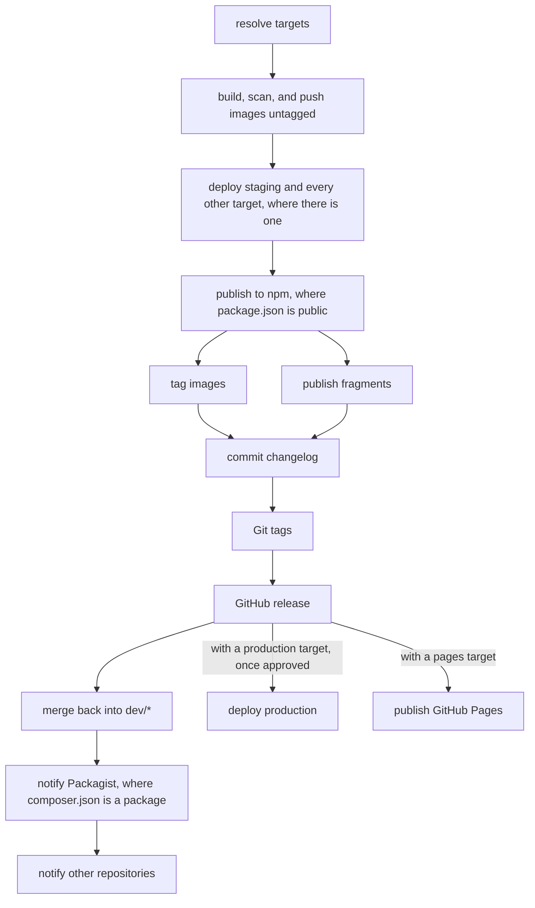

# 🔖 Releases [🔍](../src/shared/release/ 'Go to source')

The branch name decides what CI does and which version a release gets.

## Branches

| Branch | CI |
| --- | --- |
| `feature/*`, `fix/*` | checks, builds, and scans, in a pull request into `dev/*` |
| `dev/<major>.<minor>`, `dev/<major>.x` | checks, builds, and scans, and deploys `testing` where there is one |
| `hotfix/*` | checks, builds, and scans, branched from a release tag |
| `release/<major>.<minor>.<patch>` | checks, builds, scans, tags, and publishes |

A pull request into `release/*` comes from `dev/*`, or from a `hotfix/*` branched from the tag it fixes.

The release branch sets the version. Your manifests keep `0.0.0-dev`, or no version at all,
and publishing writes the real one into them.
A project with both manifests needs the same description, homepage, and license in each.
The `name` in `package.json` is `@` plus the one in `composer.json`, e.g. `@acme/user`.

## What a release publishes

- every image of a `.env.<stage>` file that sets `IMAGE_NAME`, see [your image](./images/your-image.md)
- a `package.json` that isn't `private`, to npm
- a `composer.json` whose `type` isn't `project`, to Packagist
- every `./conf/compose/*.yaml` and `./compose/*.yaml` that runs an image, as a Compose fragment

New packages on GHCR start private. Make each one public once, so other repositories can pull it.

A missing secret, or a leftover npm token, fails the run before anything is pushed,
see [trusted publishing](./github/publishing.md#trusted-publishing).

From 1.0.0 on, the release's changelog section is committed to `./changelog/<major>.x.md` before tagging.
The GitHub release carries it as notes, plus the npm tarball and a Composer zip for vendoring by hand.

Last, the release is merged into `dev/<major>.<minor>`, else `dev/<major>.x`, and the release branch is deleted.
On a conflict the run fails and keeps the branch. Then merge it yourself.
Every other repository your App is installed on gets a `brnshkr-release` dispatch. Its bump picks the release up.

## Tags

| Release | Image tags | Git tags |
| --- | --- | --- |
| `1.2.3` | `1`, `1.2`, `1.2.3` | `v1`, `v1.2`, `v1.2.3` |
| `0.2.3` | `0.2`, `0.2.3` | `v0.2`, `v0.2.3` |
| `1.3.0-rc.1` | `1.3.0-rc.1` | `v1.3.0-rc.1` |

Below 1.0.0 a minor may break, so `0` never exists. A Composer package gets only the Git tag `v1.2.3`.
Fragments take the Git tags without the `v`. Each pushed image is labeled with its version, commit, and the commit's time.

A stable release also tags `IMAGE_ALIASES`, each with `IMAGE_SUFFIX`, and the suffix alone, e.g. `forge-php:app`.
A prerelease moves neither. Forge's own aliases:

| Image | Alias |
| --- | --- |
| `forge` | `TOOLCHAIN_ALIASES`, e.g. `forge:php8.5-bun1.4-cli` |
| `forge-php` | `PHP_ALIASES`, e.g. `forge-php:php8.5-app` |
| `forge-bun` | `BUN_ALIASES`, e.g. `forge-bun:bun1.4-app-dev` |

Prereleases are `alpha`, `beta`, and `rc`, written the way npm writes them. Composer reads them the same way.
On npm, a prerelease is published as `rc`, `alpha`, or `beta` instead of `latest`.
`npm install @acme/user` keeps getting the last stable release, and `npm install @acme/user@rc` the prerelease.

## Withdrawing a release

A released version is never tagged again. If nobody may use a release anymore,
e.g. because it carries a compromised dependency, withdraw it by hand and ship the next patch:

1. Delete the GitHub release, then its `v<version>` tag. Your [tag ruleset](./github/setup.md#rulesets) has to allow it.
2. Press _Update_ on the package's Packagist page. That drops the version.
3. Run `npm unpublish @acme/user@<version>`. It works only within npm's
   [unpublish policy](https://docs.npmjs.com/policies/unpublish). If npm refuses,
   run `npm deprecate @acme/user@<version> "<reason>"` and ask npm support to remove the version.
4. Delete the version from your GHCR packages, and from your mirror if you have one.
   `:<major>` and `:<major>.<minor>` go too where they still point to it, until the next patch moves them again.
5. Publish a GitHub security advisory naming the affected versions.
